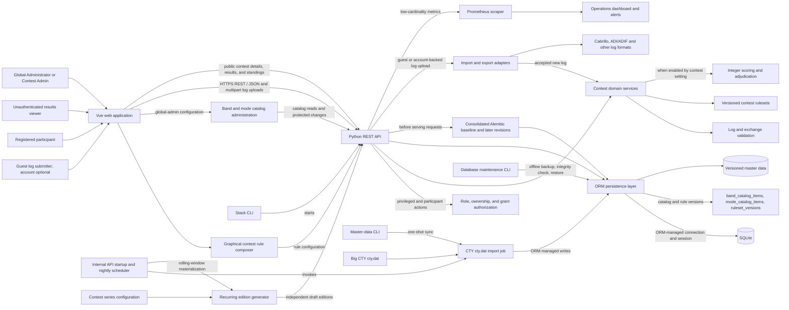
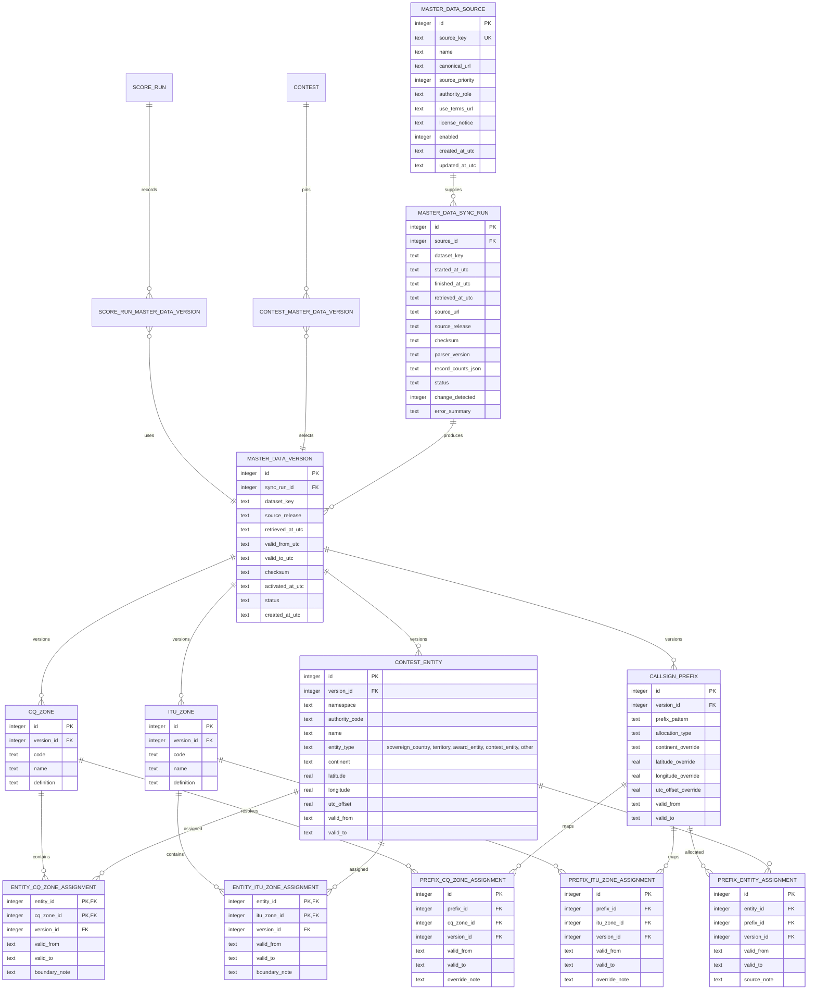

# Contestmaster: initial product and architecture overview

This document captures an initial direction for Contestmaster, a universal engine for amateur radio contests. It is a starting point: contest rules vary, so confirm each rule against the published rules for the selected contest before implementing it.

For the ordered delivery sequence, task breakdown, and release acceptance criteria, see the [implementation plan](implementation-plan/README.md).

Operational and user guides: [operators](operations/README.md), [participants](participants/README.md), [supported file formats](formats/README.md), and [security/accessibility review](security/README.md).

For supported interface languages and the localization workflow, see [internationalization](internationalization/README.md).

For a source-linked survey of contest rule patterns and their mapping to the current schema, scoring engine, and composer, see the [radio-contest rules body of knowledge](radio-contest-body-of-knowledge/README.md).

## Initial feature list

### Core platform

- Create and configure contests with a name, operating start/end times, a separate log submission cutoff, supported entry categories, and a selected ruleset and version.
- Create participant and station records from contest entry details; participants can submit logs without registering for a system account.
- Record contacts (QSOs) with UTC time, callsigns, band, mode, and contest-specific exchange data.
- Validate entries and contacts against the active contest ruleset, with clear field-level feedback.
- Calculate reproducible integer-only scores, multipliers, penalties, and standings. Retain aggregate and per-rule multiplier totals so an organizer can explain how each score formula component was reached.
- Let participants upload logs without a system account. Guests manage an entry with its receipt token; they may later register, verify their email, and claim associated guest logs by proving access with a live receipt token for the matching callsign. Keep guest-only identities out of System User Administration. Provide public contest result and standings views without login, alongside organizer views for managing contests.

### Log handling

- Add, edit, and remove contacts through the application.
- Upload logs through the participant interface and import or export them through contest-enabled Cabrillo and ADI/ADIF format adapters.
- Report malformed rows and rule violations with source-line feedback and without partially accepting an invalid log. Preserve the exact submitted source, unknown headers, and unmapped fields.
- Make upload retries idempotent per contest and content. Bound request and file sizes, sanitize filenames, and do not rate-limit log creation or file resubmission. Return an entry-scoped receipt token and store only its digest.
- Detect likely duplicate contacts and show how each contact was credited during scoring.

### Contest administration

- Create and configure contests on dedicated create/edit pages, separate from the paged contest listing. Configure UTC start/end instants, optional periodicity, and a separate log submission cutoff. Use the graphical ruleset composer on dedicated create/edit pages, separate from the paged ruleset listing, for reusable categories, bands, modes, exchange definitions, late-submission policy, and scoring rules. Both listings support server-side filtering and pagination. Global administrators maintain the shared band/mode catalog; contest managers select eligible values in their rulesets.
- Review submitted logs, run or rerun adjudication, and publish standings.
- Keep score runs tied to the exact ruleset version and input data used to produce them.
- Let contest managers review unresolved scoring items, generate result lists, and publish immutable numbered result snapshots. Public standings expose aggregate score explanations and configured entry categories, not raw QSOs or private review data.
- Track adjudication decisions and score changes for later review.
- Let global administrators review master-data versions and their effective intervals, provenance, sync outcomes, and references in a protected administration section. Permit deletion only for non-current versions not referenced by a contest or score run.

### System roles and access

The application has three roles. Participants are contest users and never receive privileged system permissions. Guest log submission remains available without registration.

- **Global Administrator:** has all system privileges, including creating and managing any account, contest, or ruleset, managing resource administrator assignments, and editing/activating master-data versions. The system must retain at least one active Global Administrator.
- **Contest Admin:** can create contests and rulesets, configure contest rules, generate results, and manage their own resources or resources assigned to them. The original creator remains permanent owner. Owners can assign or remove additional Contest Admins; assigned admins receive the same resource permissions.
- **Participant:** can optionally register with a callsign, email, and password; must verify email before password sign-in. A participant may add callsigns, access only associated entries, claim eligible guest entries with a matching live receipt token, amend/resubmit or withdraw their logs, and request password recovery by single-use email link. Existing guest receipt access and email magic links remain supported.
- **Guest log submitter:** can submit a log without an account and use an entry-scoped receipt token to manage that entry. Store only a token hash; a Contest Admin controls its expiry and can close, revoke, or rotate it.
- **Public visitor:** can view public contest results and standings without an account.

Contest and ruleset authorization is enforced in the API. Listings are scoped to owned or assigned resources. Owners retain permanent ownership even when they grant or revoke additional administrators. Global Administrators may manage any resource.

Only Global Administrators can access master-data version management in the web application. The API enforces the same role restriction. Global Administrators can inspect version and sync history, activate validated candidate versions, and delete eligible old versions. Contest Admins and public visitors cannot list, activate, or delete shared master data.

### Later capabilities

- Support additional contest formats by adding rulesets and import/export adapters rather than changing the common log workflow.
- Add live or near-live standings, multi-operator workflows, and richer log checking as requirements become clear.
- Add integrations such as external log submission or radio logging software only when a concrete interoperability need is defined.

## Initial system ruleset

The checked items in [Initial reusable rule catalog of the system](preliminary-ruleset/README.md#initial-reusable-rule-catalog-of-the-system) are adopted as Contestmaster's initial built-in reusable rule catalog. The Vue rule composer and Python ruleset interface should support these rule types from the initial implementation:

- Late-submission handling policy; UTC event dates, periodicity, and submission cutoff are contest configuration.
- Entry category dimensions and compatibility constraints.
- Declarative exchange schemas and field validators.
- QSO eligibility predicates and configurable duplicate scope.
- Integer QSO-point rules and integer-only score composition.
- Multiplier source, uniqueness scope, and eligibility.
- Bonus and penalty rules with thresholds, caps, ordering, and evidence requirements.
- Operating-time, off-time, band-change, and transmitter constraints.
- Log import/export schemas and category mapping.
- Cross-log checks, review decisions, publication, and award eligibility.
- Ruleset edition/source provenance and immutable score-run explanations.

This is the system's set of reusable rule capabilities, not one universal contest configuration. A contest manager configures the parameters and selects applicable types for each contest; the published rules for that contest govern. Each saved configuration is validated and versioned, and each score run records the exact ruleset version and explanation used.

IARU organizational regions are outside the current release: they are not a first-class master-data set, built-in contest condition, or ruleset configuration field. The active database schema and data model do not store them. Amateur-radio ITU zones remain a separate, supported contest reference and must not be conflated with IARU organizational regions. Revisit IARU-region support in the [standalone backlog issue](https://github.com/ea7klk/contestmaster/issues/77), outside the current implementation phases.

## Architecture overview

The Vue application handles contest setup, participant registration and account management, guest log upload and later entry claiming, administration, standings, and the graphical ruleset composer. Participants can register or upload logs anonymously, and anyone can view public results. System User Administration lists privileged system users and explicitly registered participant accounts; guest-only participant records remain outside that list. A registered participant claims matching guest entries by presenting a live entry receipt token for a station callsign attached to the account. Recurring schedules produce independent contest editions with their own state, logs, score runs, and results. Public contest details display the manager's description above a generated ruleset summary; rendered Markdown is sanitized. The frontend sends typed API requests and multipart uploads to the Python REST API. The API enforces Global Administrator, Contest Admin, participant, and resource-grant permissions, imports accepted logs, applies contest-domain services, and accesses SQLite only through SQLAlchemy ORM-managed sessions. Scoring is performed by a versioned ruleset implementation behind a stable interface; the backend is authoritative. Resource owners retain permanent ownership and may grant or revoke additional Contest Admins. Shared participant identities and global audit events are retained when contests are deleted.

Distance-scored rules use the entrant's Cabrillo `GRID-LOCATOR` header or each ADIF QSO's `MY_GRIDSQUARE` value (falling back to the entry station grid) and a configured received Maidenhead `grid` exchange. The scoring service calculates great-circle distance between locator cell centers at 4, 6, or 8 character precision, rounds up to commenced kilometers, and contributes integer points. `LOCATION` remains an operating-location/section field and is not interpreted as a grid. Missing or malformed locator facts follow the ruleset's explicit review or not-credited action.



### Main boundaries

- **Vue frontend:** presents workflows, sends typed API requests, lets guests upload log files without accounts, provides participants with registration, verified sign-in and entry management, and displays contest results publicly without login. It provides paged contest and ruleset management, account administration for Global Administrators, and owner controls for assigning additional Contest Admins. Contest management includes JSON import/export, Markdown descriptions and ruleset editing. The contest list uses normal page scrolling without a nested scroll region. Render manager-authored contest descriptions safely from Markdown source. The public details page places this description above a generated category/rules overview that may be imprecise; the official contest rules remain authoritative. The graphical composer validates and reviews contest rules. Show upload progress, import summaries, and actionable row-level errors. Render a shared footer on every route, including public and authenticated pages, listing each external licensed dataset used by the application with a direct link to its license or use terms. Keep the attribution list synchronized with enabled sources. Keep contest rules and final score calculations on the server.
- **Python REST API:** owns the external API contract, input validation, role and contest-scope authorization for privileged actions, guest log submission, participant credential lifecycle, public read access to contest results and standings, and ORM-managed transaction boundaries. Participant identities remain distinct from privileged accounts. Resource owners retain permanent ownership; assigned Contest Admins receive scoped access; Global Administrators can manage all users and resources. A single-process internal timer materializes editions through each series' configured rolling window and applies skip/move exceptions. Use ORM-managed connections and sessions for all application database access; application code must not open direct sqlite3 connections or issue database operations outside the ORM. Publish an OpenAPI description.
- **Contest domain:** models common contest concepts and exposes services for callsign normalization, QSO validation, duplicate selection, counterpart-log matching, scoring, and adjudication. Keep pure rule checks independent of HTTP and SQLite; ORM orchestration records immutable decisions and score runs at the application boundary.
- **Contest schedules:** one-time contests and recurring series both produce ordinary contest records. A series stores UTC recurrence configuration, duration, cutoff offset, optional rolling creation window, ruleset/default settings, and exceptions; each edition is an independent contest record with its own state and data. Managers can skip or move an occurrence, set an absolute cutoff override for an edition, or delete a whole series with its editions. The API's internal timer is the sole scheduler owner in the initial one-process deployment.
- **Rulesets:** define reusable categories, exchange interpretation, QSO eligibility predicates over contact geography, entry categories/declarations, and the station callsign, plus multipliers, penalties, and rounding rules. Multiplier uniqueness is per entry and per configured multiplier rule: `contest` counts a normalized source value once across the entry; `band`, `mode`, and `band_mode` add the selected dimension(s) to the key; `grid` groups by the worked station's received grid exchange; `transmitter` groups by the submitted transmitter value. A received grid exchange is exposed as `qso.grid`; grid-based rules require a received or bidirectional `grid` exchange field supported by every accepted upload format. Transmitter-based rules require Cabrillo as every accepted format and its optional `transmitter` QSO column. Call-sign-derived facts are explicit: `qso.entity` is CTY-resolved, `qso.wpx_prefix` applies the published WPX letter/numeral convention to the worked callsign, `qso.callsign_suffix` reads its final slash suffix, and `qso.worked_callsign` is the exact worked callsign. These source paths all refer to the worked station; original submitted calls remain preserved. A QSO missing an applicable multiplier value is sent to review and contributes no multiplier key. Sponsor rules that exclude a class of calls (such as WPX maritime-mobile calls) should conditionally exclude those contacts from that multiplier rule. CQ WW sample drafts count zone and entity once per band and exclude `/MM` contacts from the entity multiplier while retaining their zone multiplier. CW Open sessions can be represented as separate contests, which resets the entry-wide `contest` scope; combined series scoring is not part of multiplier scope. Contest start/end instants, periodicity, and log submission cutoff belong to contest configuration and are excluded from rulesets. The ruleset's submission rule only selects late-log handling. The API exposes a typed built-in rule catalog and a no-save validation endpoint that returns configuration errors, a readable summary, and an integer worked-score example. Configured cross-log workflow hooks control reciprocal-contact tolerances and whether missing/mismatched counterpart contacts require review. Submitted configuration never executes code. Contest managers author configuration through the graphical composer; validated versions are append-only, activation history is recorded per contest, and score runs retain their selected version.
- **Operating catalogs:** store reusable bands and modes in independent ORM-managed `band_catalog_items` and `mode_catalog_items` tables. The API exposes active values through separate resources; the global-admin page has distinct Bands and Modes sections, each with its own “Add catalog item” form. Eligibility selections persist stable keys in immutable ruleset configuration JSON; no foreign-key relationship makes historical snapshots depend on mutable catalog rows. Contest-free marks are advisory metadata shown in the composer and do not change scoring.
- **Adapters:** translate files and external formats into and out of the common domain model. The API enforces request and file size limits and passes file contents to import adapters; log creation and file resubmission have no application rate limit. Keep format parsing separate from validation and scoring.
- **Master-data refresh:** the initial single API process invokes a reusable, idempotent Big CTY `cty.dat` import at startup if no active CTY version exists, then runs it nightly. The same job can run once from CLI and later from a K3s CronJob as a one-shot Job. It records provenance and source terms, validates complete candidate versions, then activates safe updates through ORM-managed writes. Prevent overlapping imports, expose provisioning status, keep the last valid version active on failures, and queue interpreted boundary changes for review. Scoring that depends on callsign-derived geography pins the CTY version valid at the contest's start instant. Contest-specific identifiers come from the log exchange or ruleset.
- **Master-data version governance:** CTY is the only provisioned dataset. When a contest's rules use callsign-derived facts, pin the CTY version whose effective UTC interval contains the contest start instant; keep the reference on the contest and each score run so later imports cannot change historical interpretation. An unchanged nightly check records its sync run but creates no new data version. The global-administrator-only web section lists versions, supports activation of validated candidates, and allows deletion only for non-current versions with no contest, score-run, QSO-resolution, or other retained-record references. Enforce the role check in the API and reference restrictions in the database.
- **Global administration:** the master-data version management section is visible and accessible only to global administrators. Contest managers and public visitors cannot list, activate, or delete master-data versions.
- **Initial operations:** start the stack from CLI on one host with SQLite on local storage. Run one API process so the internal timer has a single owner; keep the nightly importer independent of HTTP startup and callable as a standalone job for future K3s scheduling.
- **Observability and recovery:** expose a protected, optional Prometheus metrics endpoint with low-cardinality counters and timings. The starter scrape configuration, dashboard, and alert rules are under `ops/observability`. Use the offline `contestmaster-db` CLI for integrity checks, verified SQLite backups, and staged atomic restore; stop the API during database maintenance. See the [operations guide](operations/README.md), [security review/accessibility checklist](security/README.md), [participant guide](participants/README.md), and [supported format list](formats/README.md).
- **SQLite:** stores application state for the initial low-concurrency deployment. All application reads and writes pass through the ORM-managed persistence layer and connections. Use ORM-compatible migrations and enforce important invariants with foreign keys, unique constraints, and transactions.
- **Schema lifecycle:** the current schema is created by one consolidated Alembic baseline. API startup applies that baseline on a new database and any later pending revisions before accepting requests. Each future data-model change is a separate Alembic revision above the baseline; the baseline stays fixed. A compatibility-only archive upgrades databases stamped with the previous migration history.

### SQLite operating guidance

SQLite fits the expected low concurrency and keeps initial deployment simple. It supports multiple readers but serializes writes, so keep write transactions short and avoid holding them open during parsing, scoring, or network calls. Enable foreign key enforcement on every connection, use a busy timeout, and consider WAL mode for reader/writer overlap. Keep the database on local storage; do not use a shared network filesystem as a multi-host database. Start with one API process and no separate job queue; move long-running recalculations to a worker only if usage or response times require it. Back up the database and test restores before relying on it for contest records.

## Initial data model

Contest ruleset configuration is authored in the visual composer, validated by the API, and saved as an immutable version. Global Administrators can administer all privileged and explicitly registered participant accounts and all resources. Guest-only participant records created during uploads are excluded from System User Administration and cannot be edited through its participant endpoints. Contest Admin permissions are scoped to permanently owned or assigned contests and rulesets; each creator remains the permanent owner. Participant records are separate from privileged system accounts. Verified participant emails support password login, recovery, two-address email changes, and magic-link access scoped to associated entries. Participant callsigns are separately managed, with the registered primary callsign protected from removal. A participant can claim eligible guest entries by proving possession of a live entry receipt for a station callsign attached to their account; the transaction links only guest-owned entries for that callsign that still have an active receipt grant. It preserves immutable revisions and existing receipt grants, and never moves entries from another registered account. An entry's submitter_user_id is nullable when a participant uploads as a guest. Guest receipt grants and optional verified guest email access are scoped to one entry and store only token hashes; result-notice consent is stored separately and requires verified email. Post-publication notices use unique outbox events after a result snapshot commits. The original Cabrillo or ADI/ADIF input is retained with each immutable entry revision. CTY is currently the only provisioned master-data dataset; a contest pins its CTY version at the start instant only when its rules use callsign-derived facts.

The active ORM schema and migration baseline contain no IARU-region table, entity assignment, or IARU-region-to-zone mapping. Contest ruleset configuration has no built-in IARU-region condition or lookup. Stable `rulesets` retain permanent ownership across immutable versions. `contest_administrators` and `ruleset_administrators` grant scoped Contest Admin access without changing resource ownership. `participant_callsigns` stores additional callsigns; participant emails, email-change confirmations, password resets, and sessions support account security. Bands and modes remain separate ORM entities. Contest-history delete guards and ruleset-version permits remain active. For SQLite compatibility with pre-existing referenced versions, `ruleset_versions.ruleset_id` is nullable and indexed but does not yet have a database foreign-key constraint; migrations backfill it where possible and API/persistence authorization validates the root association.

```mermaid
erDiagram
    SYSTEM_USER ||--o{ CONTEST : owns
    CONTEST ||--o{ CONTEST_ADMINISTRATOR : shares
    SYSTEM_USER ||--o{ CONTEST_ADMINISTRATOR : assigned
    RULESET ||--o{ RULESET_VERSION : versions
    SYSTEM_USER o|--o{ RULESET : owns
    RULESET ||--o{ RULESET_ADMINISTRATOR : shares
    SYSTEM_USER ||--o{ RULESET_ADMINISTRATOR : assigned
    SYSTEM_USER ||--o{ CONTEST_SERIES : manages
    RULESET_VERSION o|--o{ CONTEST_SERIES : defaults
    CONTEST_SERIES ||--o{ CONTEST : editions
    CONTEST_SERIES ||--o{ CONTEST_SERIES_EXCEPTION : exceptions
    SYSTEM_USER o|--o{ ENTRY : submits
    CONTEST ||--o{ ENTRY : accepts
    PARTICIPANT ||--o{ ENTRY : identifies
    PARTICIPANT ||--o{ PARTICIPANT_EMAIL : verifies
    PARTICIPANT ||--o{ PARTICIPANT_CALLSIGN : identifies
    PARTICIPANT_EMAIL ||--o{ PARTICIPANT_MAGIC_LINK : authenticates
    PARTICIPANT_EMAIL ||--o{ PARTICIPANT_SESSION : signs_in
    PARTICIPANT ||--o{ PARTICIPANT_EMAIL_CHANGE : confirms_change
    PARTICIPANT ||--o{ PARTICIPANT_PASSWORD_RESET : recovers
    SYSTEM_USER ||--o{ SYSTEM_PASSWORD_RESET : recovers
    CONTEST ||--o{ RULESET_VERSION : selects
    CONTEST ||--o{ RULESET_ACTIVATION : history
    CONTEST ||--o| CONTEST_DELETION_PERMIT : temporarily_authorizes_removal
    RULESET_VERSION ||--o| RULESET_DELETION_PERMIT : temporarily_authorizes_removal
    RULESET_VERSION ||--o{ RULESET_ACTIVATION : activated
    SYSTEM_USER o|--o{ RULESET_ACTIVATION : activates
    CONTEST ||--o{ CONTEST_MASTER_DATA_VERSION : pins
    MASTER_DATA_VERSION ||--o{ CONTEST_MASTER_DATA_VERSION : selected_for
    ENTRY ||--o{ ENTRY_REVISION : receives
    ENTRY_REVISION ||--o{ STATION : uses
    ENTRY_REVISION ||--o{ QSO : records
    QSO ||--o{ QSO_DECISION : receives
    ENTRY ||--o{ SCORE_RUN : has
    CONTEST ||--o{ RESULT_PUBLICATION : publishes
    RESULT_PUBLICATION ||--o{ RESULT_PUBLICATION_ENTRY : snapshots
    ENTRY ||--o{ RESULT_PUBLICATION_ENTRY : represents
    SCORE_RUN ||--o{ RESULT_PUBLICATION_ENTRY : selected_run
    ENTRY ||--o{ ENTRY_ACCESS_GRANT : grants
    ENTRY ||--o| GUEST_ENTRY_EMAIL : contacts
    GUEST_ENTRY_EMAIL ||--o{ GUEST_ENTRY_EMAIL_VERIFICATION : verifies
    GUEST_ENTRY_EMAIL ||--o{ ENTRY_ACCESS_GRANT : authorizes
    GUEST_ENTRY_EMAIL ||--o{ EMAIL_OUTBOX : receives
    RESULT_PUBLICATION ||--o{ EMAIL_OUTBOX : queues
    CONTEST ||--o{ LOG_SUBMISSION_REQUEST : deduplicates
    ENTRY ||--o{ LOG_SUBMISSION_REQUEST : identifies
    ENTRY_REVISION ||--o{ SCORE_RUN : scores
    RULESET_VERSION ||--o{ SCORE_RUN : evaluates
    SCORE_RUN ||--o{ SCORE_RUN_MASTER_DATA_VERSION : records
    MASTER_DATA_VERSION ||--o{ SCORE_RUN_MASTER_DATA_VERSION : used_by
    SCORE_RUN ||--o{ QSO_SCORE : explains
    QSO ||--o{ QSO_SCORE : credited_in
    CONTEST_ENTITY o|--o{ QSO : resolves
    CQ_ZONE o|--o{ QSO : resolves
    ITU_ZONE o|--o{ QSO : resolves
    CONTEST ||--o{ ADMIN_NOTE : contains
    SYSTEM_USER o|--o{ AUDIT_EVENT : performs
    SYSTEM_USER o|--o{ ADMIN_NOTE : writes

    SYSTEM_USER {
        integer id PK
        text username UK
        text role
    }
    CONTEST_ADMINISTRATOR {
        integer contest_id PK, FK
        integer user_id PK, FK
        integer added_by_user_id FK
        text added_at_utc
    }
    RULESET {
        integer id PK
        text ruleset_key UK
        integer owner_user_id FK
        text created_at_utc
    }
    RULESET_ADMINISTRATOR {
        integer ruleset_id PK, FK
        integer user_id PK, FK
        integer added_by_user_id FK
        text added_at_utc
    }
    CONTEST {
        integer id PK
        integer owner_user_id FK
        integer series_id FK "nullable"
        text series_occurrence_date "nullable UTC date"
        integer is_series_anchor
        text name
        text description "nullable Markdown source"
        text starts_at_utc
        text ends_at_utc
        json periodicity
        text log_submission_cutoff_at_utc
        integer cutoff_is_override
        text status
        integer ruleset_version_id FK
        integer auto_recalculate_on_upload
    }
    CONTEST_SERIES {
        integer id PK
        integer owner_user_id FK
        text name
        text base_slug
        json periodicity
        integer start_time_seconds_utc
        integer duration_seconds
        integer cutoff_offset_seconds
        integer automatic_window_days "nullable disables generation"
        integer ruleset_version_id FK
    }
    CONTEST_SERIES_EXCEPTION {
        integer id PK
        integer series_id FK
        text occurrence_date_utc
        text action "skip or move"
        text moved_to_date_utc "nullable"
    }
    CONTEST_DELETION_PERMIT {
        integer contest_id PK "temporary FK to contest"
    }
    CONTEST_MASTER_DATA_VERSION {
        integer id PK
        integer contest_id FK
        text dataset_key
        integer master_data_version_id FK
        text pinned_at_utc
    }
    PARTICIPANT {
        integer id PK
        text display_name
        text callsign_submitted
        text callsign_normalized
        text password_hash "nullable for guest-only identities"
        integer is_active
    }
    PARTICIPANT_CALLSIGN {
        integer id PK
        integer participant_id FK
        text callsign_submitted
        text callsign_normalized
        integer is_primary
        text verified_at_utc "nullable"
    }
    PARTICIPANT_EMAIL {
        integer id PK
        integer participant_id FK
        text email_normalized UK
        text verified_at_utc
        integer is_primary
        integer is_active
    }
    PARTICIPANT_EMAIL_CHANGE {
        integer id PK
        integer participant_id FK
        integer old_email_id FK
        text new_email_normalized
        text old_token_hash UK
        text new_token_hash UK
        text confirmation_times_utc
    }
    PARTICIPANT_PASSWORD_RESET {
        integer id PK
        integer participant_id FK
        integer participant_email_id FK
        text token_hash UK
        text expires_at_utc
        text consumed_at_utc "nullable"
    }
    SYSTEM_PASSWORD_RESET {
        integer id PK
        integer user_id FK
        text token_hash UK
        text expires_at_utc
        text consumed_at_utc "nullable"
    }
    PARTICIPANT_SESSION {
        integer id PK
        integer participant_email_id FK
        text token_hash UK
        text csrf_token_hash
        text created_at_utc
        text expires_at_utc
        text revoked_at_utc
    }
    PARTICIPANT_MAGIC_LINK {
        integer id PK
        integer participant_email_id FK
        text token_hash UK
        text created_at_utc
        text expires_at_utc
        text consumed_at_utc
    }
    RULESET_VERSION {
        integer id PK
        integer ruleset_id "nullable indexed root reference; legacy compatibility"
        text ruleset_key
        text version
        text source_url
        text source_edition
        text rule_type_keys_json
        text configuration_json
    }
    RULESET_DELETION_PERMIT {
        integer ruleset_version_id PK "temporary FK to ruleset version"
    }
    BAND_CATALOG_ITEM {
        integer id PK
        text key
        text label
        text description
        text frequency_range
        integer sort_order
        integer is_active
        integer contest_free
    }
    MODE_CATALOG_ITEM {
        integer id PK
        text key
        text label
        text description
        integer sort_order
        integer is_active
    }
    RULESET_ACTIVATION {
        integer id PK
        integer contest_id FK
        integer ruleset_version_id FK
        integer activated_by_user_id FK
        text configuration_sha256
        text activated_at_utc
    }
    ENTRY {
        integer id PK
        integer contest_id FK
        integer participant_id FK
        integer submitter_user_id FK
        text category_values_json
        integer is_late
        text submitted_at_utc
        text status
    }
    ENTRY_REVISION {
        integer id PK
        integer entry_id FK
        integer revision_number
        text input_format
        text storage_key
        text original_content
        text import_metadata_json
        text content_sha256
        integer received_by_participant_email_id FK
        text received_via
        text submitted_at_utc
        text received_at_utc
    }
    ENTRY_ACCESS_GRANT {
        integer id PK
        integer entry_id FK
        integer guest_email_id FK "nullable"
        text token_hash UK
        text created_at_utc
        text expires_at_utc
        text revoked_at_utc
    }
    GUEST_ENTRY_EMAIL {
        integer id PK
        integer entry_id FK UK
        text email_normalized
        text source
        integer access_opt_in
        integer results_opt_in
        text verified_at_utc "nullable"
        text revoked_at_utc "nullable"
    }
    GUEST_ENTRY_EMAIL_VERIFICATION {
        integer id PK
        integer guest_email_id FK
        text token_hash UK
        text expires_at_utc
        text consumed_at_utc "nullable"
    }
    EMAIL_OUTBOX {
        integer id PK
        text event_key UK
        integer guest_email_id FK
        integer publication_id FK
        text state
        integer attempt_count
        text available_at_utc
        text sent_at_utc "nullable"
        text last_error "safe exception class only"
    }
    LOG_SUBMISSION_REQUEST {
        integer id PK
        integer contest_id FK
        text key_sha256
        text content_sha256
        integer entry_id FK
        text created_at_utc
    }
    STATION {
        integer id PK
        integer entry_revision_id FK
        text callsign_submitted
        text callsign_normalized
        text station_configuration_json
    }
    QSO {
        integer id PK
        integer entry_revision_id FK
        text occurred_at_utc
        text callsign_submitted
        text callsign_normalized
        text band
        text mode
        text exchange_sent_submitted_json
        text exchange_sent_normalized_json
        text exchange_received_submitted_json
        text exchange_received_normalized_json
        integer resolved_master_data_version_id FK
        integer worked_entity_id FK
        integer worked_cq_zone_id FK
        integer worked_itu_zone_id FK
    }
    QSO_DECISION {
        integer id PK
        integer qso_id FK
        integer reviewer_user_id FK
        integer supersedes_decision_id FK
        text status
        text source
        text reason_code
        text reason
        text evidence_json
        text created_at_utc
    }
    SCORE_RUN {
        integer id PK
        integer entry_id FK
        integer entry_revision_id FK
        integer ruleset_version_id FK
        text input_digest
        text ruleset_snapshot_json
        text master_data_snapshot_json
        text explanation_json
        text status
        text created_at_utc
        integer claimed_points
        integer points
        integer multiplier_count
        integer bonus_points
        integer penalty_points
        integer final_score
        integer adjudicated_score
    }
    RESULT_PUBLICATION {
        integer id PK
        integer contest_id FK
        integer publication_number
        text source_digest
        integer entry_count
        integer withheld_count
        integer published_by_user_id FK
        text published_at_utc
        integer is_sealed
    }
    RESULT_PUBLICATION_ENTRY {
        integer id PK
        integer publication_id FK
        integer entry_id FK
        integer score_run_id FK
        text callsign
        text category_values_json
        text status
        integer score
        integer points
        integer multiplier_count
        integer bonus_points
        integer penalty_points
        integer qso_count
        integer credited_qso_count
        integer placement
        text explanation_json
    }
    SCORE_RUN_MASTER_DATA_VERSION {
        integer id PK
        integer score_run_id FK
        text dataset_key
        integer master_data_version_id FK
    }
    QSO_SCORE {
        integer id PK
        integer score_run_id FK
        integer qso_id FK
        integer entry_revision_id FK
        integer credited
        text status
        integer points
        integer bonus_points
        text reason_codes_json
        text multiplier_keys_json
        text explanation
    }
    ADMIN_NOTE {
        integer id PK
        integer contest_id FK
        integer entry_id FK
        integer author_user_id FK
        text body
    }
    AUDIT_EVENT {
        integer id PK
        integer actor_user_id FK
        text action
        text target_type
        text target_id
        text occurred_at_utc
    }
```

`CONTEST.description` is an existing nullable text column. It stores the manager-authored Markdown source; the contest editor provides a WYSIWYG editor and sanitized preview, while the public detail page uses the same safe Markdown renderer. This authored description is separate from the ruleset-derived “Contest rules at a glance” overview. The overview explains category dimensions, required/optional selections, choices, optional dimension and choice descriptions, declaration markings, and mutually exclusive dimensions. It also lists the importer-required Cabrillo or ADIF headers and QSO fields for each enabled format, together with ruleset-configured allowed bands, modes, and required exchange constraints or values. It uses general wording for known dimensions when a ruleset has no description and warns that sponsor rules define exact qualifications and limits; it may still be imprecise and does not replace the sponsor's official published rules.

`BAND_CATALOG_ITEM` and `MODE_CATALOG_ITEM` are independent global-admin-managed reference tables. Both have stable keys, labels, descriptions, sort order, and active state. Bands additionally store frequency reference text and the advisory contest-free mark. The active band catalog ends at 10 GHz and marks 2200 m, 630 m, 60 m, 30 m, 17 m, and 12 m as no-contest advisory bands; higher-frequency legacy catalog keys remain inactive for compatibility with saved rulesets. The consolidated Alembic baseline creates and seeds these tables. `RULESET_VERSION.configuration_json` stores selected band/mode keys in the immutable ruleset snapshot. This intentional JSON reference avoids making historical versions depend on mutable catalog rows; referenced keys cannot be renamed or deleted, and deactivation does not rewrite saved rulesets.

### Data and scoring conventions

- Store contest start, end, and log submission cutoff as separate UTC timestamps with a documented, consistent precision. The cutoff is independent of the operating end time and governs acceptance of new log submissions. SQLite can store them as ISO 8601 text; convert to local time at display or file-format boundaries.
- Use integer values only for points, bonuses, penalties, multipliers, intermediate score values, and final scores. Never use floating-point or decimal values for scoring. If a published rule yields a fractional result, apply its specified rounding rule and keep the stored result an integer.
- Keep each score run immutable or auditable: a changed log or ruleset should produce a new run, not silently rewrite the prior explanation.
- Store aggregate and per-rule multiplier counts and per-rule bonus award counts in the score-run explanation JSON. Published snapshots copy these safe counts into the versioned public explanation; they do not expose QSO facts or review notes.
- A manager publication copies selected latest completed runs into a sealed, immutable snapshot with a numbered publication and source digest. Re-publication appends a snapshot. Withdrawn entries are excluded; late, checklog, and unresolved entries are withheld by default; reclassified and disqualified entries are included with status labels by default. Disqualified entries have zero score and no placement. A `result_publication` ruleset hook may explicitly change these inclusion booleans.
- Public standings and `results-v1` JSON/CSV exports are generated from publication snapshots, never from mutable current score-run state. Public responses include aggregate score explanations and configured categories only; original logs remain receipt/participant/manager scoped.
- Keep ruleset versions, accepted entry revisions, station/QSO input, adjudication decisions, and audit events append-only during ordinary operation. A completed score run and its per-QSO explanations are immutable at the database level; corrections create a new revision or score run. The authorized contest-deletion workflow can remove only the selected contest's dependent history through a transaction-scoped database permit; shared participants and global audit events remain. Private staff notes can be edited, with material administrative actions recorded in the audit trail.
- Honor the contest's auto_recalculate_on_upload setting after a new log has been accepted and imported. A rejected or malformed upload must not trigger automatic result generation.
- Treat JSON configuration and exchange payloads as untrusted input. Validate their schema and preserve the original submitted exchange when a normalized interpretation is stored.
- Add indexes based on actual query needs, especially for contacts by entry, time, band, and callsign. Keep uniqueness rules contest-aware; a duplicate definition can vary by ruleset.

### Retention and visibility defaults

Treat these as product defaults to confirm for the deployment's jurisdiction and contest requirements. Restrict access in API serialization as well as the UI; hiding a link is not authorization.

- Keep original uploaded log files private. Entrants can access their own entry through its receipt grant or verified participant access; the contest's managers and global administrators can access it for adjudication. Public result pages never expose original files, raw QSO records, participant email addresses, receipt-token hashes, or private staff notes.
- Retain the original uploaded file until 12 months after the result is final, then remove the blob unless an appeal, dispute, or legal hold is active. Keep the revision metadata and cryptographic digest for provenance after blob deletion; do not overwrite an earlier revision when a replacement is submitted.
- Retain parsed QSO input, adjudication decisions, ruleset/master-data snapshots, and score explanations for five years after final results to support reproducibility and appeals. Mark this as a configurable deployment policy; a legal hold extends retention.
- Keep verified participant email addresses and account recovery/access records private. Expire and remove consumed or expired magic-link token hashes after 30 days. Revoke entry grants at closure or expiry and retain only non-secret audit metadata about that action.
- Limit administrative notes to authorized staff for the associated contest. Retain audit events for 90 days, with daily ORM-backed pruning; audit metadata must not contain credentials, bearer tokens, raw log data, email bodies, or unnecessary personal data. Global Administrators can search the retained audit history in the administration UI.
- Provide an authorized deletion/anonymization workflow after applicable retention ends. Preserve contest result records and non-identifying score evidence where required, and record the deletion action without copying the deleted personal data into the audit event.

## Geographic and callsign master data

Designate permitted Big CTY `cty.dat` data as the only externally provisioned master-data source for nightly imports and callsign resolution, preserving its applicable license notice. Its callsign mappings cover prefixes, DXCC entities, continents, CQ zones, and amateur-radio ITU zones. The hosted service will never ingest or redistribute the ARRL DXCC list; contest-published rules remain authoritative for scoring definitions and exceptions. Keep CQ zones and amateur ITU zones distinct. Contest-specific sections, states, provinces, grids, serials, and station identifiers come from submitted exchanges and configured rulesets.

Use normalized ORM tables and effective-dated assignments. An entity can span more than one zone, and a zone can include parts of several entities, so zone membership must not be a single zone column on the entity. A logged callsign, portable prefix, operating location, or a contest's own definitions may be needed to resolve the right zone. Keep international prefix-block allocation separate from the prefix rules a contest uses to parse a callsign.

The [master-data guide](master-data/README.md) identifies the CTY source, update approach, and reuse limitations. The nightly importer saves retrieval metadata and checksums, validates a complete candidate dataset before activation, and retains prior versions. A timeout, parse error, empty response, or incomplete download must leave the last valid data active. Public availability does not grant permission to redistribute a dataset: follow CTY's applicable notice and terms.



The diagram is logical rather than a required physical schema. Big CTY is the only enabled source, stored under dataset key `cty`; it supplies callsign-derived entity, prefix, CQ-zone, ITU-zone, continent, and geographic reference facts, while contest publications govern how those facts are interpreted. Source and version records retain provenance, license/use terms, checksums, and effective intervals. The source priority and authority role fields describe source metadata; they do not arbitrate between feeds in this CTY-only setup. `namespace` and `entity_type` distinguish award-defined entities (such as DXCC) from contest-defined entities. The diagram names the current ORM tables, including `prefix_entity_assignments`, `entity_cq_zone_assignments`, `entity_itu_zone_assignments`, `prefix_cq_zone_assignments`, and `prefix_itu_zone_assignments`; they carry effective dates and source/version provenance. Prefix assignments support more than one allocation target and time period. Prefix-based zone mappings from Big CTY support callsign resolution; they do not replace a contest's published exceptions or a location supplied in a QSO exchange. Preserve old versions referenced by historical logs or score runs. All tables and sync operations use the Python ORM and ORM-managed transactions. Contest-specific station and exchange identifiers belong in each contest's ruleset.

On startup, import Big CTY if no active CTY version exists; then check it nightly. Expose whether initial provisioning is pending, active, or failed. Rules that use callsign-derived facts require a CTY version valid at contest start, and scoring must block if no version covers that instant. Validate a complete CTY candidate before activation, preserve the last good version on failure, and stage material changes for review. The dated release and checksum identify upstream changes; unchanged normalized content records a successful sync without creating a new version or changing effective intervals. A global administrator can inspect source/run/version metadata and activate validated candidates in the web UI. Deletion is allowed only for a non-current version with no contest, score-run, QSO-resolution, or other retained-record references; keep versions needed for historical result reproduction.
