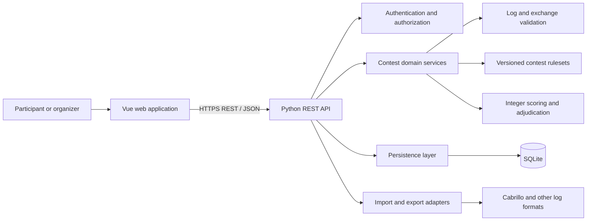
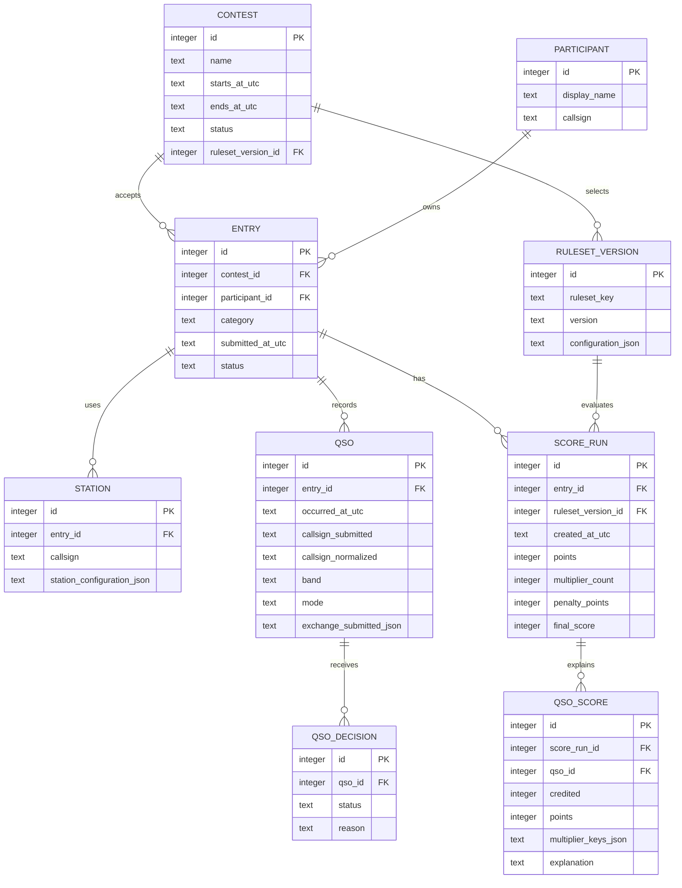

# Contestmaster: initial product and architecture overview

This document captures an initial direction for Contestmaster, a universal engine for amateur radio contests. It is a starting point: contest rules vary, so confirm each rule against the published rules for the selected contest before implementing it.

## Initial feature list

### Core platform

- Create and configure contests with a name, schedule, supported entry categories, and a selected ruleset and version.
- Register participants and stations, then create one or more contest entries for them.
- Record contacts (QSOs) with UTC time, callsigns, band, mode, and contest-specific exchange data.
- Validate entries and contacts against the active contest ruleset, with clear field-level feedback.
- Calculate reproducible integer-only scores, multipliers, penalties, and standings. Retain a breakdown so an organizer can explain how a result was reached.
- Provide participant views for entering and reviewing a log, and organizer views for managing a contest and reviewing results.

### Log handling

- Add, edit, and remove contacts through the application.
- Import and export logs through format adapters, starting with Cabrillo where appropriate.
- Report malformed rows and rule violations without silently discarding submitted data.
- Detect likely duplicate contacts and show how each contact was credited during scoring.

### Contest administration

- Configure ruleset options, contest dates, categories, bands, modes, and exchange definitions.
- Review submitted logs, run or rerun adjudication, and publish standings.
- Keep score runs tied to the exact ruleset version and input data used to produce them.
- Track adjudication decisions and score changes for later review.

### Later capabilities

- Support additional contest formats by adding rulesets and import/export adapters rather than changing the common log workflow.
- Add live or near-live standings, multi-operator workflows, and richer log checking as requirements become clear.
- Add integrations such as external log submission or radio logging software only when a concrete interoperability need is defined.

## Architecture overview

The Vue application handles contest setup, log entry, administration, and standings display. It calls a Python REST API, which authenticates and validates requests, applies contest domain services, and reads or writes persistent data in SQLite. Scoring is performed by a versioned ruleset implementation behind a stable interface; the browser may provide immediate convenience checks, but the backend remains authoritative.

### Main boundaries

- **Vue frontend:** presents workflows and sends typed API requests. Keep contest rules and final score calculations on the server.
- **Python REST API:** owns the external API contract, input validation, authorization, and transaction boundaries. Publish an OpenAPI description.
- **Contest domain:** models common contest concepts and exposes services for validation, scoring, adjudication, and standings. Keep it independent of HTTP and SQLite.
- **Rulesets:** define contest-specific categories, exchange interpretation, QSO eligibility, multipliers, penalties, and rounding rules. Store the ruleset identifier and version with each contest and score run.
- **Adapters:** translate files and external formats into and out of the common domain model. Keep format parsing separate from validation and scoring.
- **SQLite:** stores application state for the initial low-concurrency deployment. Use migrations and enforce important invariants with foreign keys, unique constraints, and transactions.

### SQLite operating guidance

SQLite fits the expected low concurrency and keeps initial deployment simple. It supports multiple readers but serializes writes, so keep write transactions short and avoid holding them open during parsing, scoring, or network calls. Enable foreign key enforcement on every connection, use a busy timeout, and consider WAL mode for reader/writer overlap. Keep the database on local storage; do not use a shared network filesystem as a multi-host database. Start with one API deployment and no separate job queue; move long-running recalculations to a worker only if usage or response times require it. Back up the database and test restores before relying on it for contest records.

## Initial data model

The model below is a starting point. Keep common fields relational and allow contest-specific exchanges and rule configuration to be stored as validated structured data. Preserve submitted values when normalization is needed for matching or scoring.

### Data and scoring conventions

- Use UTC timestamps with a documented, consistent precision. SQLite can store them as ISO 8601 text; convert to local time at display or file-format boundaries.
- Use integer values only for points, bonuses, penalties, multipliers, intermediate score values, and final scores. Never use floating-point or decimal values for scoring. If a published rule yields a fractional result, apply its specified rounding rule and keep the stored result an integer.
- Keep each score run immutable or auditable: a changed log or ruleset should produce a new run, not silently rewrite the prior explanation.
- Treat JSON configuration and exchange payloads as untrusted input. Validate their schema and preserve the original submitted exchange when a normalized interpretation is stored.
- Add indexes based on actual query needs, especially for contacts by entry, time, band, and callsign. Keep uniqueness rules contest-aware; a duplicate definition can vary by ruleset.
