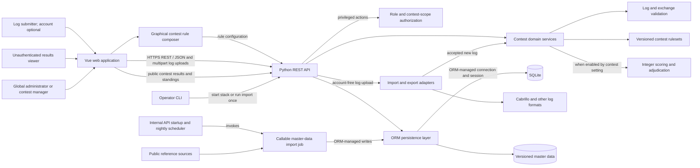
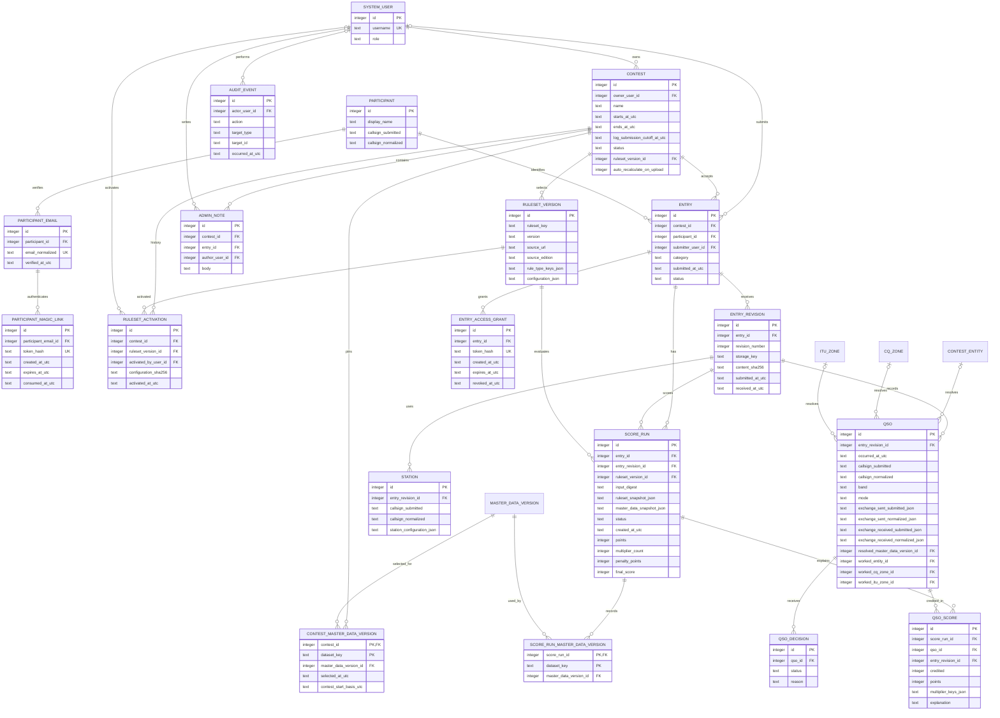
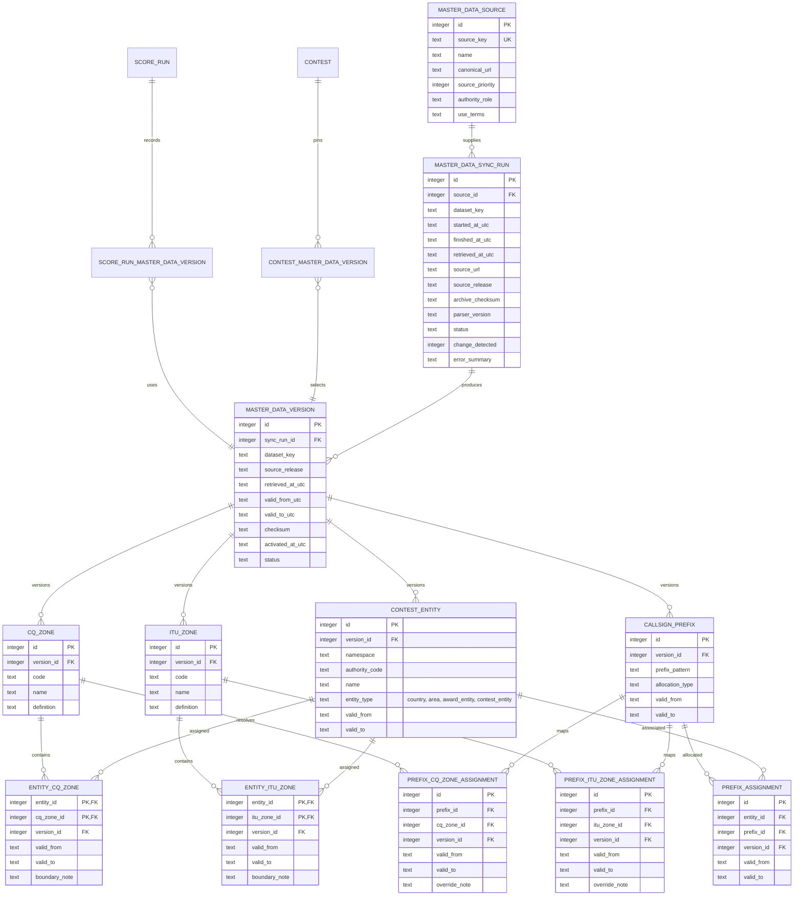

# Contestmaster: initial product and architecture overview

This document captures an initial direction for Contestmaster, a universal engine for amateur radio contests. It is a starting point: contest rules vary, so confirm each rule against the published rules for the selected contest before implementing it.

For the ordered delivery sequence, task breakdown, and release acceptance criteria, see the [implementation plan](implementation-plan/README.md).

## Initial feature list

### Core platform

- Create and configure contests with a name, operating start/end times, a separate log submission cutoff, supported entry categories, and a selected ruleset and version.
- Create participant and station records from contest entry details; participants can submit logs without registering for a system account.
- Record contacts (QSOs) with UTC time, callsigns, band, mode, and contest-specific exchange data.
- Validate entries and contacts against the active contest ruleset, with clear field-level feedback.
- Calculate reproducible integer-only scores, multipliers, penalties, and standings. Retain a breakdown so an organizer can explain how a result was reached.
- Let participants upload logs without a system account. Guests manage an entry with its receipt token; registered participants can use email magic links for entries associated with their verified email. Provide public contest result and standings views without login, alongside organizer views for managing contests.

### Log handling

- Add, edit, and remove contacts through the application.
- Upload logs through the participant interface and import or export them through format adapters, starting with Cabrillo where appropriate.
- Report malformed rows and rule violations without silently discarding submitted data.
- Detect likely duplicate contacts and show how each contact was credited during scoring.

### Contest administration

- Create and configure contest rulesets with a simple graphical rule composer. Configure contest operating times, the separate log submission cutoff, categories, bands, modes, exchange definitions, and whether accepted new log uploads automatically trigger result recalculation.
- Review submitted logs, run or rerun adjudication, and publish standings.
- Keep score runs tied to the exact ruleset version and input data used to produce them.
- Track adjudication decisions and score changes for later review.
- Let global administrators review master-data versions and their effective intervals, provenance, sync outcomes, and references in a protected administration section. Permit deletion only for non-current versions not referenced by a contest or score run.

### System roles and access

The system has two privileged account roles. A participant is a contest identity, not a privileged system account, and does not need to register before submitting a log. A participant who registers and verifies an email address can request a short-lived, single-use email magic link to access only associated entries. This access never grants a global administrator or contest manager role.

- **Global administrator:** has all privileges across the system and all contests.
- **Contest manager:** can create and manage their own contests, configure those contests' rules and automatic recalculation setting, run contest result generation, and generate contest result lists. Contest managers do not have global administrator privileges.
- **Guest log submitter:** can submit a contest log without an account and use an entry-scoped receipt token to manage that entry. Store only a token hash; the contest manager controls its expiry and can close, revoke, or rotate it. The submission is associated with a participant/entry record, while its system-account submitter reference remains empty.
- **Registered participant:** can verify an email address and use a short-lived, single-use email magic link to manage only entries associated with that identity. Participant identity and entry access do not grant privileged system roles.
- **Public visitor:** can view contest results and standings in the web frontend without an account. Viewing results does not grant contest-management privileges.

Only global administrators can access master-data version management in the web application. The API must enforce the same role restriction. Global administrators can inspect version and sync history, activate validated candidate versions, and delete eligible old versions. Contest managers and public visitors cannot list, activate, or delete shared master data.

### Later capabilities

- Support additional contest formats by adding rulesets and import/export adapters rather than changing the common log workflow.
- Add live or near-live standings, multi-operator workflows, and richer log checking as requirements become clear.
- Add integrations such as external log submission or radio logging software only when a concrete interoperability need is defined.

## Initial system ruleset

The checked items in [Initial reusable rule catalog of the system](preliminary-ruleset/README.md#initial-reusable-rule-catalog-of-the-system) are adopted as Contestmaster's initial built-in reusable rule catalog. The Vue rule composer and Python ruleset interface should support these rule types from the initial implementation:

- Contest schedule and UTC log submission cutoff.
- Entry category dimensions and compatibility constraints.
- Declarative exchange schemas and field validators.
- QSO eligibility predicates and configurable duplicate scope.
- Integer QSO-point rules and integer-only score composition.
- Multiplier source, uniqueness scope, and eligibility.
- Bonus and penalty rules with thresholds, caps, ordering, and evidence requirements.
- Operating-time, off-time, band-change, and transmitter constraints.
- Log import/export schemas and category mapping.
- Cross-log checks, review decisions, publication, and award eligibility.
- Ruleset edition/source provenance and immutable score-run explanations.

This is the system's set of reusable rule capabilities, not one universal contest configuration. A contest manager configures the parameters and selects applicable types for each contest; the published rules for that contest govern. Each saved configuration is validated and versioned, and each score run records the exact ruleset version and explanation used.

IARU organizational regions are outside the current release: they are not a first-class master-data set, built-in contest condition, or ruleset configuration field. The active database schema and data model do not store them. Amateur-radio ITU zones remain a separate, supported contest reference and must not be conflated with IARU organizational regions. Revisit IARU-region support in the [standalone backlog issue](https://github.com/ea7klk/contestmaster/issues/77), outside the current implementation phases.

## Architecture overview

The Vue application handles contest setup, log entry, log-file selection and upload, administration, standings display, and a simple graphical rule composer for contest managers. Participants can upload logs and anyone can view contest results and standings without creating system accounts; privileged contest-management actions require authentication. It sends API requests and multipart log uploads to the Python REST API. The API authenticates privileged actions, checks global administrator or contest-manager permissions, accepts eligible log submissions without an account, passes uploaded files to import adapters, applies contest domain services, and accesses SQLite only through the ORM persistence layer using ORM-managed connections and sessions. Scoring is performed by a versioned ruleset implementation behind a stable interface; the browser may provide immediate convenience checks, but the backend remains authoritative.

### Main boundaries

- **Vue frontend:** presents workflows, sends typed API requests, lets participants upload log files without requiring accounts, displays contest results and standings publicly without login, and provides a simple graphical rule composer for contest managers. Show upload progress, import summaries, and actionable row-level errors. Render a shared footer on every route, including public and authenticated pages, listing each external licensed dataset used by the application with a direct link to its license or use terms. Keep the attribution list synchronized with enabled sources. Keep contest rules and final score calculations on the server.
- **Python REST API:** owns the external API contract, input validation, role and contest-scope authorization for privileged actions, account-free log submission, public read access to contest results and standings, and ORM-managed transaction boundaries. Use ORM-managed connections and sessions for all application database access; application code must not open direct sqlite3 connections or issue database operations outside the ORM. Publish an OpenAPI description.
- **Contest domain:** models common contest concepts and exposes services for validation, scoring, adjudication, and standings. Keep it independent of HTTP and SQLite.
- **Rulesets:** define contest-specific categories, exchange interpretation, QSO eligibility, multipliers, penalties, and rounding rules. The API exposes a typed built-in rule catalog and a no-save validation endpoint that returns configuration errors, a readable summary, and an integer worked-score example. Contest managers author configuration through the graphical composer; validated versions are append-only, activation history is recorded per contest, and score runs retain their selected version.
- **Adapters:** translate files and external formats into and out of the common domain model. The API enforces upload limits and passes file contents to import adapters. Keep format parsing separate from validation and scoring.
- **Master-data refresh:** the initial single API process invokes a reusable, idempotent import job at startup if no active master-data version exists, then runs it nightly. The same job can run once from CLI and later from a K3s CronJob as a one-shot Job. It checks configured public reference sources, records provenance and source terms, validates complete candidate versions, then activates safe updates through ORM-managed writes. Prevent overlapping imports, expose provisioning status, keep the last valid version active on failures, and queue interpreted boundary changes for review. Scoring that depends on master data requires a version valid at the contest's start instant.
- **Master-data version governance:** each dataset version has an effective UTC interval. For a contest, pin the version of each required dataset whose interval contains the contest start instant; keep those references on the contest and each score run so later source updates cannot change historical interpretation. An unchanged nightly check records its sync run but creates no new data version. A global-administrator-only web section lists versions, supports activation of validated candidates, and allows deletion only for non-current versions with no contest, score-run, QSO-resolution, or other retained-record references. Enforce the role check in the API and reference restrictions in the database.
- **Global administration:** add a master-data version management section visible and accessible only to global administrators. Contest managers and public visitors cannot list, activate, or delete master-data versions.
- **Initial operations:** start the stack from CLI on one host with SQLite on local storage. Run one API process so the internal timer has a single owner; keep the nightly importer independent of HTTP startup and callable as a standalone job for future K3s scheduling.
- **SQLite:** stores application state for the initial low-concurrency deployment. All application reads and writes pass through the ORM-managed persistence layer and connections. Use ORM-compatible migrations and enforce important invariants with foreign keys, unique constraints, and transactions.

### SQLite operating guidance

SQLite fits the expected low concurrency and keeps initial deployment simple. It supports multiple readers but serializes writes, so keep write transactions short and avoid holding them open during parsing, scoring, or network calls. Enable foreign key enforcement on every connection, use a busy timeout, and consider WAL mode for reader/writer overlap. Keep the database on local storage; do not use a shared network filesystem as a multi-host database. Start with one API process and no separate job queue; move long-running recalculations to a worker only if usage or response times require it. Back up the database and test restores before relying on it for contest records.

## Initial data model

The model below is a starting point. Contest ruleset configuration is authored in the visual composer, validated by the API, and saved as a versioned configuration. Privileged system roles are only for global administrators and contest managers; participant records are contest identities and do not require a privileged account. Verified participant emails support short-lived, single-use magic-link sign-in scoped to associated entries. An entry's submitter_user_id is nullable when a participant uploads a log as a guest. Guest receipt grants are scoped to one entry, manager-controlled for expiry and revocation, and store only a token hash. Keep common fields relational and allow contest-specific exchanges and rule configuration to be stored as validated structured data. Preserve submitted values when normalization is needed for matching or scoring. Each contest pins the required master-data dataset versions valid at its start; score runs preserve those exact version references.

The active ORM schema and migration head contain no IARU-region table, entity assignment, or IARU-region-to-zone mapping. The migration history removes those unused tables; migration tests guard their continued absence. Contest ruleset configuration has no built-in IARU-region condition or lookup. Rule versions and activations use ORM-managed tables; the `ruleset_activations` rows append the selected version, actor, timestamp, and configuration digest without mutating its immutable definition.

### Data and scoring conventions

- Store contest start, end, and log submission cutoff as separate UTC timestamps with a documented, consistent precision. The cutoff is independent of the operating end time and governs acceptance of new log submissions. SQLite can store them as ISO 8601 text; convert to local time at display or file-format boundaries.
- Use integer values only for points, bonuses, penalties, multipliers, intermediate score values, and final scores. Never use floating-point or decimal values for scoring. If a published rule yields a fractional result, apply its specified rounding rule and keep the stored result an integer.
- Keep each score run immutable or auditable: a changed log or ruleset should produce a new run, not silently rewrite the prior explanation.
- Keep ruleset versions, accepted entry revisions, station/QSO input, adjudication decisions, and audit events append-only. A completed score run and its per-QSO explanations are immutable at the database level; corrections create a new revision or score run. Private staff notes can be edited, with material administrative actions recorded in the audit trail.
- Honor the contest's auto_recalculate_on_upload setting after a new log has been accepted and imported. A rejected or malformed upload must not trigger automatic result generation.
- Treat JSON configuration and exchange payloads as untrusted input. Validate their schema and preserve the original submitted exchange when a normalized interpretation is stored.
- Add indexes based on actual query needs, especially for contacts by entry, time, band, and callsign. Keep uniqueness rules contest-aware; a duplicate definition can vary by ruleset.

### Retention and visibility defaults

Treat these as product defaults to confirm for the deployment's jurisdiction and contest requirements. Restrict access in API serialization as well as the UI; hiding a link is not authorization.

- Keep original uploaded log files private. Entrants can access their own entry through its receipt grant or verified participant access; the contest's managers and global administrators can access it for adjudication. Public result pages never expose original files, raw QSO records, participant email addresses, receipt-token hashes, or private staff notes.
- Retain the original uploaded file until 12 months after the result is final, then remove the blob unless an appeal, dispute, or legal hold is active. Keep the revision metadata and cryptographic digest for provenance after blob deletion; do not overwrite an earlier revision when a replacement is submitted.
- Retain parsed QSO input, adjudication decisions, ruleset/master-data snapshots, and score explanations for five years after final results to support reproducibility and appeals. Mark this as a configurable deployment policy; a legal hold extends retention.
- Keep verified participant email addresses and account recovery/access records private. Expire and remove consumed or expired magic-link token hashes after 30 days. Revoke entry grants at closure or expiry and retain only non-secret audit metadata about that action.
- Limit administrative notes to authorized staff for the associated contest. Retain audit events for three years; audit metadata must not contain credentials, bearer tokens, raw log data, email bodies, or unnecessary personal data.
- Provide an authorized deletion/anonymization workflow after applicable retention ends. Preserve contest result records and non-identifying score evidence where required, and record the deletion action without copying the deleted personal data into the audit event.

## Geographic and callsign master data

Designate permitted Big CTY `cty.dat` data as the primary operational source for nightly master-data imports and callsign resolution, preserving its applicable license notice. Its callsign mappings cover prefixes, DXCC entities, CQ zones, and amateur-radio ITU zones. The hosted service will never ingest or redistribute the ARRL DXCC list; use permitted sources for operational mappings and each contest's published rules for scoring definitions. Maintain normalized master data for those fields alongside country/area identifiers. Use the source catalog's permitted authority references to validate CTY data and fill fields it does not contain; contest-published rules remain authoritative for adjudication. Keep the concepts distinct: CQ zones and amateur ITU zones are different contest systems, and a contest entity such as a DXCC entity is not necessarily a sovereign country. Configure contest-specific station and exchange identifiers in the contest's ruleset. Store UNGEGN WGN and UNSD M49 country/area rows under separate dataset versions in the generic `CONTEST_ENTITY` table; the M49 importer retains only the published country/area name and numeric code.

Use normalized ORM tables and effective-dated assignments. An entity can span more than one zone, and a zone can include parts of several entities, so zone membership must not be a single zone column on the entity. A logged callsign, portable prefix, operating location, or a contest's own definitions may be needed to resolve the right zone. Keep international prefix-block allocation separate from the prefix rules a contest uses to parse a callsign.

The source catalog in [Master data source recommendations](master-data/README.md) identifies the designated primary source, validation and gap-filling authorities, update approach, and known reuse limitations. The nightly importer should save retrieval metadata and checksums, validate a complete candidate dataset before activation, and retain prior versions. A timeout, parse error, empty response, or incomplete download must leave the last valid data active. Public availability does not grant permission to redistribute a dataset: source-specific terms must be checked before enabling automated ingestion or serving copied content.

The diagram is logical rather than a required physical schema. `MASTER_DATA_SOURCE.source_priority` and `authority_role` identify the import order and whether a source is the primary operational feed, a governing authority, or a gap-filling reference. Big CTY has primary operational priority for its supported mappings; CQ and contest publications govern contest interpretation. `namespace` and `entity_type` distinguish geographic country/area identities (such as M49) from award-defined entities (such as DXCC) and contest-specific entities. Both WGN and UNSD M49 records use `CONTEST_ENTITY` with namespace `UN-M49`, but belong to separate `MASTER_DATA_VERSION.dataset_key` values so each source remains independently attributable and effective-dated. The UNSD adapter persists only the published country/area name and numeric code. Join tables such as `ENTITY_CQ_ZONE`, `ENTITY_ITU_ZONE`, `PREFIX_CQ_ZONE_ASSIGNMENT`, and `PREFIX_ITU_ZONE_ASSIGNMENT` should carry effective dates, source/version provenance, and optional boundary notes or geometry references. Prefix assignments should support more than one allocation target and time period. A prefix-based zone mapping from Big CTY is the primary operational call-sign resolution mapping; it does not replace entity-to-zone geography or a contest's published boundary rules. Preserve removed records as inactive or expired rows instead of deleting identifiers referenced by historical logs or score runs. All tables and sync operations use the Python ORM and ORM-managed transactions. Contest-specific station and exchange identifiers are configured in each contest's ruleset.

Run an initial source check/import at API startup when no valid active version exists, then run one scheduled source check/import each night. Expose whether initial provisioning is pending, active, or failed; scoring that requires the data must wait for a valid version. Sources with published change feeds or daily transactions can be applied incrementally; static publications should be checked for a changed release, ETag, or checksum. Validate keys, counts, relationships, effective dates, and expected completeness before activation. Retain each prior version and associate each contest with the exact version of each required dataset whose effective interval contains its start instant. Use that pinned set for all score runs; never substitute the latest version at scoring time. If no version covers contest start, block dependent scoring and report the missing dataset. For sources that require human interpretation, the nightly process should create a review candidate rather than silently changing contest classifications.

Compare the canonical parsed checksum with the current version for each dataset. When the content is unchanged, record a successful `unchanged` sync outcome but do not create or activate a new `MasterDataVersion` or alter its effective interval. A real change closes the prior interval and starts a new one at activation time. A global administrator can inspect version and sync metadata and activate validated candidate versions in the web UI. Deletion is allowed only for a non-current version with no contest, score-run, QSO-resolution, or other retained-record references; retain versions needed for historical result reproduction.
