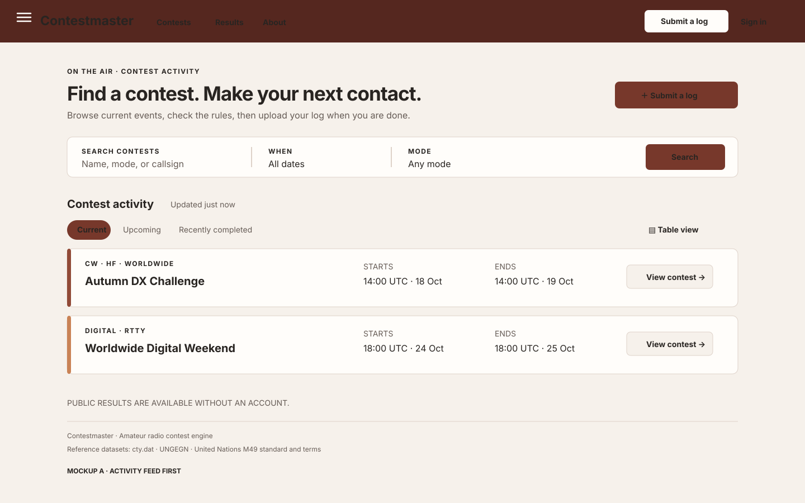
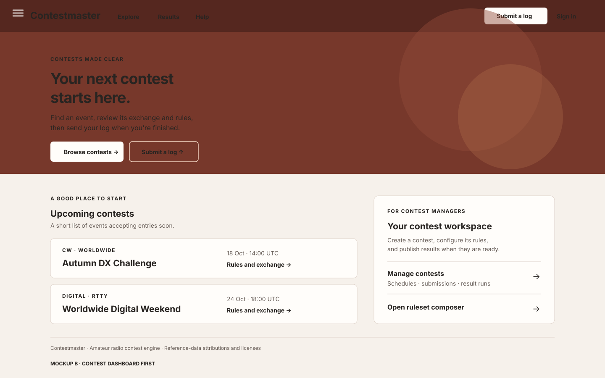
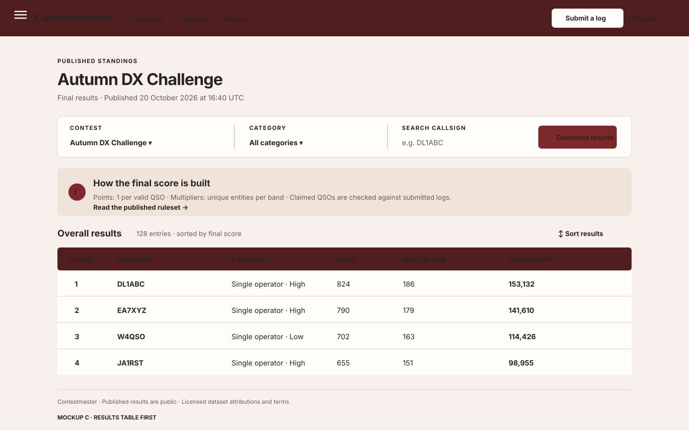

# Contestmaster web design direction

This document records the approved visual and interaction direction for the Vue application and keeps the other mockups for reference.

## Reference review: POTA.app

Reviewed on 2026-10-16. The live POTA site is a JavaScript application, so its public page is not fully represented by text-only inspection. POTA's own help material and the indexed live page show a compact set of section links for spots, activations, maps, park lists, and leaderboards; a callsign/park search; a filter-first active feed; and more than one way to view results. Its hunter guide describes a three-bar menu with view preferences such as a table view and a low-light mode. See [POTA.app](https://pota.app/), the [POTA.app help index](https://docs.pota.app/pota_app/index.html), and the [POTA Hunter Guide](https://docs.pota.app/docs/hunter_guide-english.html).

The useful design ideas are:

- Put the main activity and the next useful action near the top of the page.
- Keep navigation to a small set of task-oriented destinations; move secondary choices into a menu on narrow screens.
- Make search, filters, sorting, and view choice easy to find on data-heavy pages.
- Give live or recently updated items a clear status and timestamp.
- Let people choose a compact table view when scanning many records.

Contestmaster should apply these ideas to contests, log submissions, and published standings. It should not copy POTA's logo, wording, exact page composition, imagery, or product-specific features.

## Approved direction: layout A with a redder palette

On 2026-10-16, the user selected layout A and asked for a more reddish palette in [the approval comment on issue #86](https://github.com/ea7klk/contestmaster/issues/86#issuecomment-6210406692). Use the activity-feed-first landing-page hierarchy, with a deep red-brown header and controls, pale warm surfaces, and a restrained warm accent. Keep body copy and data tables high contrast. Status meaning must not depend on color alone. Recheck the documented WCAG contrast pairs if palette tokens change.

| Token | Approved value | Use |
| --- | --- | --- |
| Brand 900 | `#511e20` | Header, headings, strong emphasis |
| Brand 800 | `#652629` | Open mobile navigation surface |
| Brand 700 | `#7d292b` | Primary buttons and selected navigation |
| Brand 600 | `#a33c3d` | Links and secondary actions |
| Brand 500 | `#9f3e3d` | Home-page radio signal illustration |
| Brand soft | `#f5d0c6` | Supporting text over brand surfaces |
| Brand washes | `#f8ece7`, `#f5e5df` | Badges and hover surfaces |
| Accent | `#ce6a54` | Small highlights and focus treatment |
| Canvas | `#f7f0ec` | Application background |
| Surface | `#fffdfa` | Cards, menus, and tables |
| Muted surface | `#f0e6df` | Secondary panels and control surfaces |
| Ink | `#282421` | Main text |
| Muted ink | `#655b55` | Supporting text |
| Border | `#ded2c9` | Separators and control outlines |
| Strong border | `#8d7770` | Input and table boundaries |
| Status colors | Success `#23573d` / `#e8f5ed`; error `#7a1d1d` / `#fff0f0` | Status text and surfaces |

Use a compact top bar on desktop with the Contestmaster wordmark, the highest-use destinations, and an account/action area. At viewports up to 1240 CSS pixels wide, replace the destination links with a labelled menu button. The menu opens a clearly bounded panel, exposes its expanded state to assistive technology, closes with Escape, and returns focus to the menu button. Navigation remains usable by keyboard and touch. Do not hide the main action (such as “Submit a log”) inside a deep menu.

Retain the shared licensed-data footer on every route. In long data views it can follow the page content; it must remain in the document and reachable by keyboard. Keep form labels, table headings, visible focus, status text, and error explanations. Apply the established accessible form and table practices in [AGENTS.md](../../AGENTS.md) and the [security/accessibility guide](../security/README.md).

Contrast ratios below use the WCAG relative-luminance calculation for the approved CSS token values. Text pairs exceed 4.5:1; the focus indicator exceeds the 3:1 non-text target.

| Foreground and background | Ratio |
| --- | ---: |
| Primary link (`#7d292b`) on surface (`#fffdfa`) | 9.30:1 |
| Secondary link (`#a33c3d`) on surface (`#fffdfa`) | 6.32:1 |
| Main text (`#282421`) on canvas (`#f7f0ec`) | 13.65:1 |
| Muted text (`#655b55`) on surface (`#fffdfa`) | 6.50:1 |
| Strong border (`#8d7770`) on surface (`#fffdfa`) | 4.13:1 |
| Header text (`#f9eeeb`) on brand (`#511e20`) | 11.86:1 |
| Secondary header text (`#f0dad5`) on brand (`#511e20`) | 10.08:1 |
| Surface button text (`#fffdfa`) on primary button (`#7d292b`) | 9.30:1 |
| Success text (`#23573d`) on success surface (`#e8f5ed`) | 7.48:1 |
| Error text (`#7a1d1d`) on error surface (`#fff0f0`) | 9.39:1 |
| Focus ring (`#a33c3d`) on surface (`#fffdfa`) | 6.32:1 |

Automated axe checks cover the public home page and application shell. A headless Chromium smoke check at 1440×1000 and 390×844 confirmed desktop/mobile navigation states, persistent log submission access, Escape dismissal and focus restoration, close-on-route-selection, no page-level horizontal overflow, and keyboard scrolling of the standings region. It measured a 364-pixel visible table region over a 760-pixel table, with the right arrow scrolling the region by 160 pixels.

Frontend verification on 2026-10-16: `npm test -- --run` passed (20 files, 56 tests); `npm run build` passed; and `npm run lint` passed without warnings. The Chromium viewport pass also checked the mobile log-submission form at 390 CSS pixels; the document width matched the viewport and the form card fit inside it.

No human screen-reader session or manual checks in Firefox, Safari, or physical mobile browsers have been performed. The automated Chromium and axe results do not replace those checks.

Layout A is the approved starting point. The activity-first page should present the public contest activity the API actually provides and must not imply a real-time feed or schedule data that is unavailable. Keep the main log-submission action prominent. Use B and C only as reference for their participant action hierarchy and results-table treatment; they are not alternate implementation targets.

Wide standings and master-data tables stay inside labelled, keyboard-focusable regions with left/right arrow and Home/End scrolling.

## Mockup alternatives

Each SVG is a static design study at desktop size. It shows the redder approved palette and an example of the hamburger control; responsive behavior is specified above.

### A — Activity feed first

Opens on current and upcoming contests with quick status filters and direct log submission. This is the closest adaptation of POTA's scan-and-filter rhythm. It makes current activity discoverable, but needs care to avoid suggesting that Contestmaster has a map or real-time spot feed.

### B — Contest dashboard first

Opens with a clear “find a contest / submit a log” choice, followed by upcoming contests and a separate organizer workspace. This gives new participants a direct route while keeping manager tasks visible to signed-in managers. It has more explanatory content and less at-a-glance density.

### C — Results table first

Opens on published standings, with contest selection, category filters, sorting, and a compact results table. This is strongest for returning users who want results quickly, but gives log submission and contest discovery less prominence on the landing page.

## Implementation tracking

Implementation is tracked by [parent issue #87](https://github.com/ea7klk/contestmaster/issues/87): [shared design tokens](https://github.com/ea7klk/contestmaster/issues/88), [responsive navigation](https://github.com/ea7klk/contestmaster/issues/89), [activity-first home page](https://github.com/ea7klk/contestmaster/issues/90), and [responsive contest and participant views](https://github.com/ea7klk/contestmaster/issues/91). Preserve Contestmaster's accessibility and shared licensed-data footer requirements throughout the redesign.
