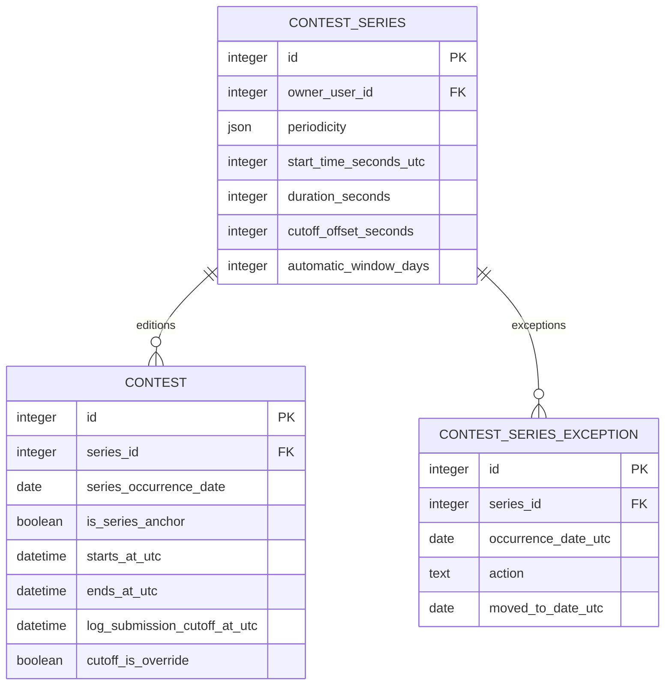

# Recurring contests

## Model

A recurring series stores a UTC recurrence pattern, the first edition's UTC start time, event duration, submission-cutoff offset, optional automatic creation window, shared description/ruleset defaults, and manager-owned exceptions. Every occurrence is a separate `contests` row. Each edition owns its own lifecycle state, logs, revisions, scoring runs, and publications. The original contest becomes the series anchor; generated editions start as drafts and can be managed independently.

Supported patterns are:

- Annual calendar date.
- Nth weekday in selected months, including one or more selected weekdays and the last occurrence.
- First, last, or Nth full weekend (Saturday and Sunday both fall within the month); Nth full weekends can be selected across multiple months.

All recurrence dates and times are resolved in UTC. The schedule preview returns the next five occurrences. If an annual date does not occur in a given year (such as February 29 in a non-leap year), that year is skipped. When a selected month has no fifth weekday or fifth full weekend, that month/weekday combination is skipped while other selected dates still recur. Existing single month and weekday values remain accepted in imported contest JSON; multi-selections use arrays.

## Edition creation and exceptions

Automatic creation is controlled by an optional 1–730 day rolling window. When enabled, the single API process runs the same idempotent edition generator at startup and on its internal timer (hourly by default). It creates only missing dates within the window. When disabled, managers may still add editions by managing their series manually. The API timer setting is controlled by `CONTEST_SCHEDULER_ENABLED` and `CONTEST_SCHEDULER_INTERVAL_SECONDS`.

Managers may add an exception for a scheduled date:

- **Skip:** suppress that occurrence. An already-created edition may be removed only if it has no submitted logs.
- **Move:** keep the occurrence but place its edition on another UTC date. Removing the exception restores the scheduled date.

The database enforces one edition per series occurrence date and one exception per scheduled date. Deleting a whole series requires exact-name confirmation and cascades through editions using the existing authorized contest deletion workflow; shared participant identities and global audit events remain retained.

## Submission cutoff

The series stores an elapsed cutoff offset from each edition's end. The editor accepts whole hours or whole days. Generated edition cutoffs equal `ends_at + cutoff_offset`. Changing the series duration or offset recalculates derived cutoffs for existing editions. A manager may set an absolute UTC cutoff override on any individual edition; that value is preserved when the series changes. Moving an edition updates a derived cutoff and preserves an override.

## API and UI

The contest editor exposes recurrence pattern selection, a five-occurrence preview, automatic rolling-window settings, exception management, and the series deletion action. The API exposes series exception list/create/delete operations and a protected series delete endpoint. Every endpoint checks the contest manager's ownership or global-administrator role. A series-linked edition cannot be deleted as a standalone contest.

## Data model

