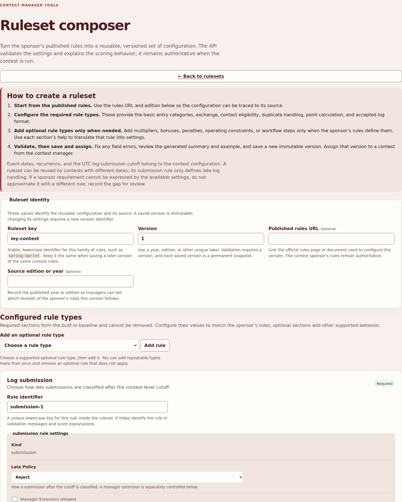
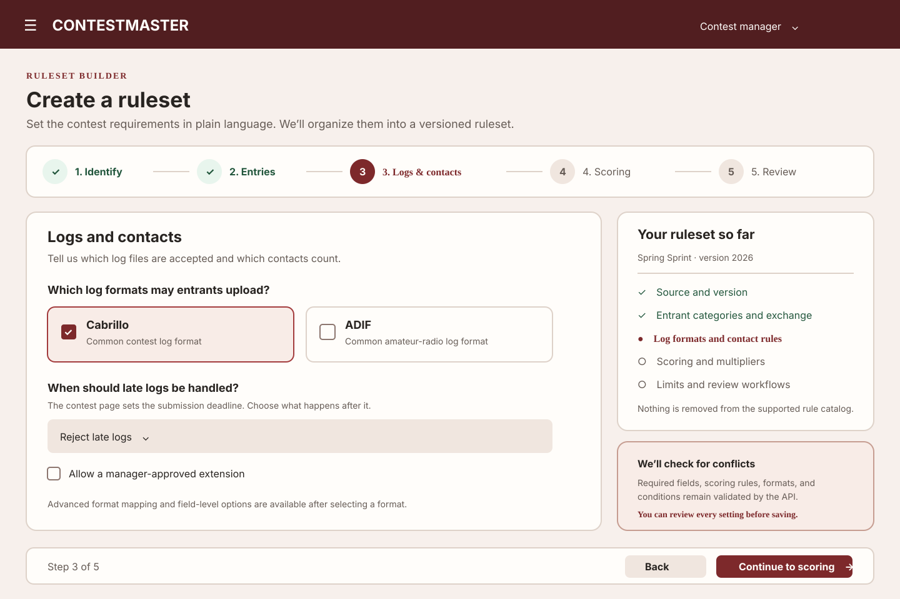
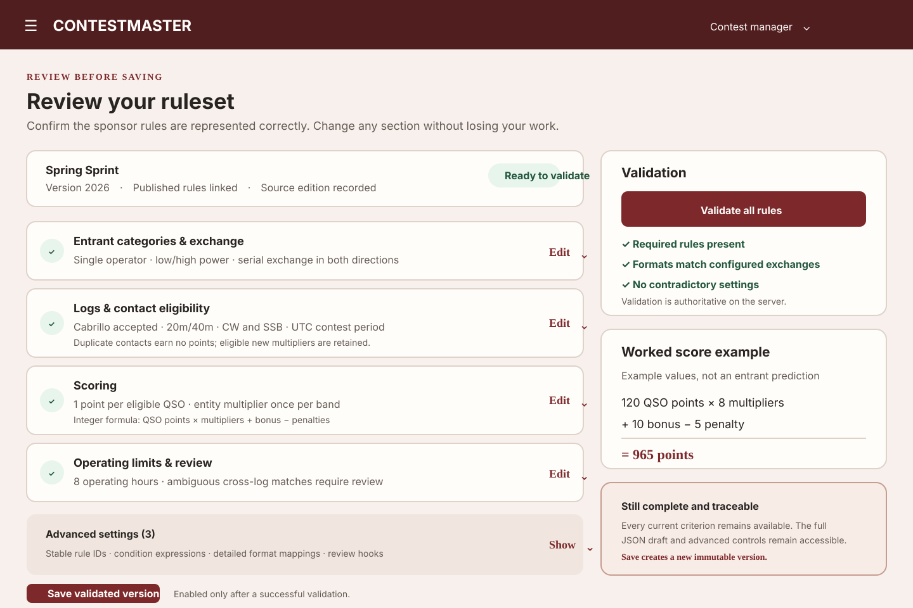

# Ruleset composer: simplification proposal

**Status:** discovery and design suggestions only. No application behavior or ruleset criteria are changed by this proposal. The mockups illustrate possible interactions; they are not implementation specifications.

## Summary

The composer exposes a capable rules engine, but asks managers to understand its internal structure before they can describe a contest. A new draft opens as a long page with the provenance form, eight required rule cards, a generic rule-schema editor, and extensive explanations. Optional rule types are added through a separate selector. Some settings depend on work done in another card, so managers must mentally translate sponsor language into multiple technical sections and then validate the combination.

I recommend keeping all current capabilities and server-side validation while changing the authoring flow to progressive disclosure. Ask about the contest rule in familiar language, group related decisions into a small number of steps, provide sensible reviewed defaults, and show the generated ruleset structure only when a manager wants it. End with one review screen that keeps every setting inspectable and links errors to their fields.

The aim is to make the first useful ruleset easier to create, not to reduce the expressiveness or authority of the existing ruleset format.

## Current composer

This is a browser capture of the current `RulesetComposerView` at 1440 × 1800. The Vue component is mounted directly with the real built-in rule catalog; catalog HTTP responses are stubbed for the capture. The capture shows the new-draft defaults and the top of the page, including the full workflow guide, provenance fields, optional-rule selector, and first required rule card. The application-wide navigation and footer are outside this component capture.

### Findings from the implementation

1. **The page starts by explaining the whole process, then presents the entire configuration.** The four-step guide is followed by four provenance fields, the optional-rule selector and all required rule cards in one scrolling page. The guide repeats instructions that appear again in field and rule help.
2. **The default form is already large before the manager adds anything.** A new draft seeds eight required rule cards: Log submission, Categories, Exchange schema, QSO eligibility, Duplicate scope, QSO points, Score formula, and Format mapping. Each card includes a technical rule identifier and a schema editor. Some of these rule types contain nested lists, conditions, or mappings.
3. **The generic schema editor exposes the data model.** It provides flexible controls, but managers encounter values such as stable keys, rule IDs, fact paths, scope, and integer formula operations while they are trying to transcribe sponsor rules.
4. **Related choices are separated.** Managers configure categories and exchanges before the format mapping that refers to them. Eligibility is split between schema fields, band/mode catalog checkboxes, an eligibility condition editor, and a separate general “apply this rule only when…” condition. Multiplier, bonus, penalty, operating constraints, and workflow hooks are added elsewhere through a type picker.
5. **The composer needs accurate detail, but currently delivers it as a lot of text at once.** Help is important because contest rules vary, but paragraphs are repeated inline even when the associated advanced setting is not relevant to the current draft.
6. **Validation is strong but comes late in the interaction.** Managers edit many sections, run validation, interpret path-based errors, correct the fields, and repeat. There is no at-a-glance completeness view tying the configured settings back to the sponsor's rules.
7. **The versioning model is sound and should remain visible.** Ruleset key, version, source URL, and source edition explain provenance. Saved versions are immutable, so making a new version must remain explicit.

### Main sources reviewed

- [RulesetComposerView.vue](../../../frontend/src/views/RulesetComposerView.vue) — default rule seeding, provenance, optional rules, validation, save, import/export, and current page layout.
- [RuleSchemaEditor.vue](../../../frontend/src/components/RuleSchemaEditor.vue) — generic schema-generated inputs, nested arrays/objects, enum controls, and conditional fields.
- [CategoryExchangeEditor.vue](../../../frontend/src/components/CategoryExchangeEditor.vue) — category dimensions, category choices, exchange fields, and their specialized controls.
- [EligibilityCatalogEditor.vue](../../../frontend/src/components/EligibilityCatalogEditor.vue) and [ConditionEditor.vue](../../../frontend/src/components/ConditionEditor.vue) — catalog selections and condition building.
- [registry.py](../../../backend/app/rulesets/registry.py) and [schema.py](../../../backend/app/rulesets/schema.py) — the actual supported rule catalog and typed fields.
- [validation.py](../../../backend/app/rulesets/validation.py) — required rules, cross-rule checks, and compatibility constraints.

## Suggested experience

### 1. Use five task-focused steps

Keep the whole workflow on a single ruleset draft, but show one focused step at a time with a persistent progress summary. This avoids both the current long scroll and a set of disconnected forms.

| Step | Manager-facing task | Existing configuration kept in the step |
| --- | --- | --- |
| 1. Identify the rules | Name this ruleset version and cite the sponsor source | Ruleset key, version, published rules URL, source edition/year |
| 2. Classify entrants | Define result categories and what entrants exchange | Category dimensions/choices/compatibility and ordered exchange fields/validators |
| 3. Logs and contacts | Select accepted formats and define what contacts count | Late-log policy, format mappings, header/category/exchange mappings, eligibility predicates, bands/modes, eligibility actions, duplicate identity/effect, duplicate multiplier option |
| 4. Scoring | Describe points and how the final score is calculated | QSO points/lookups, multiplier sources/scopes/conditions, bonuses/evidence/caps/order, penalties/consequences/caps, integer score formula and rounding |
| 5. Limits and review | Configure operating limits and work needing comparison or review | Operating/off-time/band/transmitter constraints, cross-log hooks, adjudication/review, publication and award eligibility |

Keep **Validate** and **Save validated version** as explicit actions on the final review step. Saving continues to create an immutable version; changes to a saved version require a new version identifier. Contest event dates, recurrence, and submission cutoff stay on contest configuration, as they do today.

### 2. Ask high-level questions first; reveal detail only when needed

- Offer familiar choices first, such as accepted log formats, entry dimensions, allowed bands/modes, and whether multipliers apply. Use the current catalog and dimension/choice dropdowns rather than free-form text wherever those catalogs already constrain values.
- Reveal dependent configuration after the manager selects a feature. For example, selecting Cabrillo opens its required WWROF header and QSO mappings; selecting ADIF opens its supported required fields; enabling a dimension opens its choices; enabling a multiplier opens its source, uniqueness scope, and eligibility.
- Put conditional rules behind a clear “Add a condition” action. Keep simple conditions readable in plain language and expose fact paths/operators in a details drawer for users who need them. Preserve both rule-level conditions and the eligibility-specific contact predicate because they answer different questions.
- Generate technical rule IDs from the chosen rule and hide them by default. Keep them editable in advanced details and in JSON import/export so existing references and validation paths remain available.
- Show a rule's explanation next to its decision, but collapse long examples and less-common options behind “Why is this needed?” and “Advanced options”. Do not hide errors or constraints from a manager.

### 3. Make the final review the control center

The review screen should summarize settings in contest language, show whether each required rule is complete, and let the manager expand or edit each group. Validation should report each conflict in direct language, link to its section/field, and retain the current backend's precise path and message for diagnosis. After successful server validation, show the generated rules summary and worked integer-score example before enabling the immutable-version save action.

Maintain the current JSON draft import and export actions. They are useful for advanced editing, reproducible examples, and transferring a configuration. Imported drafts must use the same validation path and must not bypass ruleset compatibility checks.

## Visual concepts

These mockups use the existing red-brown visual system. Example values are illustrative and do not describe a real contest or prescribe contest-specific scoring.

### Guided configuration step

### Review and validation

## Capability-preservation checklist

Every supported rule type and associated criterion remains configurable. The proposal changes where and when controls appear; it does not delete a rule, relax validation, infer sponsor policy, or move contest schedule data into the reusable ruleset.

| Current capability | Proposed place | Preservation notes |
| --- | --- | --- |
| Submission policy and manager extension | Step 3: Logs and contacts | The contest still owns the absolute UTC cutoff. Ruleset choices still govern reject/late/checklog handling and any explicitly allowed extension. |
| Category dimensions, choices, declarations, exclusions, and compatibility | Step 2: Classify entrants | Keep stable keys, labels, descriptions, required/declaration semantics, and incompatible-combination checks. |
| Ordered exchange fields and validation | Step 2: Classify entrants | Keep field keys/labels, type, direction, required status, choices, bounds, serial scope, and supported validators. |
| QSO eligibility and failure action | Step 3: Logs and contacts | Keep callsign/self-contact, time, required exchange, geographic/category predicates, configured bands/modes, and uncredited/review decisions. Keep advisory contest-free band status visible. |
| Duplicate scope, outcome, and optional multiplier credit | Step 3: Logs and contacts | Duplicates still earn no QSO points. The existing setting that allows an otherwise-eligible duplicate to contribute a new multiplier stays explicit and defaults off. |
| QSO points and lookup/default behavior | Step 4: Scoring | Preserve supported facts, integer values, lookup entries, and explicit default handling. |
| Multiplier source, scope, conditions, and eligibility | Step 4: Scoring | Preserve all current source choices, uniqueness scopes, and whether a qualifying contact earns points, a multiplier, both, or neither. |
| Bonus points, thresholds, evidence, caps, basis, and order | Step 4: Scoring | Keep integer-only scoring and every current per-contact/per-entry and formula-order option. |
| Penalty triggers, consequences, point amount, and cap | Step 4: Scoring | Preserve removal/uncredited/review/reclassification/disqualification consequences and integer penalties. |
| Score formula and rounding | Step 4: Scoring | Preserve operation order and supported integer arithmetic/rounding; no decimal score values. Keep the server-generated worked example. |
| Operating time/off-time, band-change, and transmitter limits | Step 5: Limits and review | Preserve all configured constraints and explicit reject/uncredited/review consequences. |
| Cabrillo and ADIF mappings | Step 3: Logs and contacts | A selected format opens its specific mapping. Cabrillo defaults remain in WWROF-required order, with no duplicate columns; category mappings continue to use configured dimensions. ADIF continues to enforce importer-required fields. Only implemented upload formats can be selected. |
| Cross-log, adjudication, publication, and award workflows | Step 5: Limits and review | Preserve all supported hooks and human-review paths; never substitute guessed behavior for a sponsor rule. |
| Rule-level `when` and eligibility-specific `eligible_if` conditions | Steps 3–5 where relevant | Keep these separate, validate supported facts/operators, and retain the advanced condition editor for nested expressions. |
| Provenance, versioning, JSON import/export | Steps 1 and 5 | Preserve ruleset key, immutable version, source URL/edition, current imported JSON shape, and authoritative validation. |

## Safeguards and open questions before implementation

- **Show all required decisions without overwhelming a first-time manager.** A step cannot be marked complete just because defaults were inserted. Clearly distinguish a sponsor-confirmed choice from a safe system default that still needs review.
- **No silent scoring defaults.** If the published rules don't define a value, don't invent one. Make uncertainty visible and let the API's existing validation block saving when required information is absent or contradictory.
- **Keep advanced options discoverable.** A manager must be able to locate every current criterion without reading JSON or knowing a schema key. Advanced controls should be labeled with plain-language meaning and searchable from review.
- **Keep one source of truth.** Continue to build the same schema-versioned `RulesetDraft`; server validation and current API compatibility checks remain authoritative. Do not introduce a second wizard-only scoring representation.
- **Preserve useful diagnostics.** Translate validator paths into step, section, and field links without discarding the original path/message. Revalidation must focus or announce the first error accessibly.
- **Test all transitions and exports.** If approved later, verify that each currently supported rule can be created, edited, imported, exported, validated, and saved in the guided UI; test conditional reveal/hide without data loss and ensure existing saved drafts still load.
- **Decide whether both guided and direct/advanced editing are needed.** The mockups assume a focused guided flow plus advanced details in context. User testing should determine whether a separate “full configuration” view is also necessary.

## Recommendation

Proceed with a guided, progressively disclosed composer and a grouped review screen, retaining the current JSON and advanced controls. Before implementation, review these mockups and confirm whether the five-step grouping fits how you read contest rules. No UI implementation has been started as part of this document.
